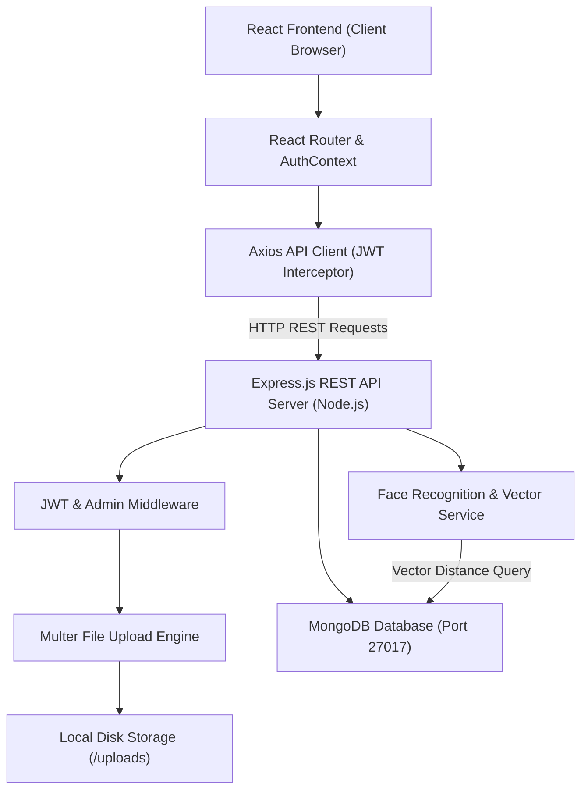
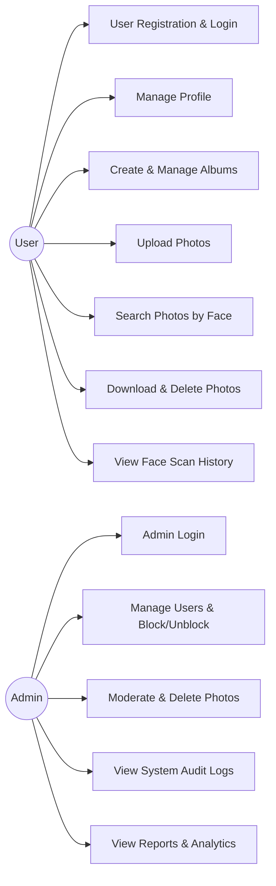
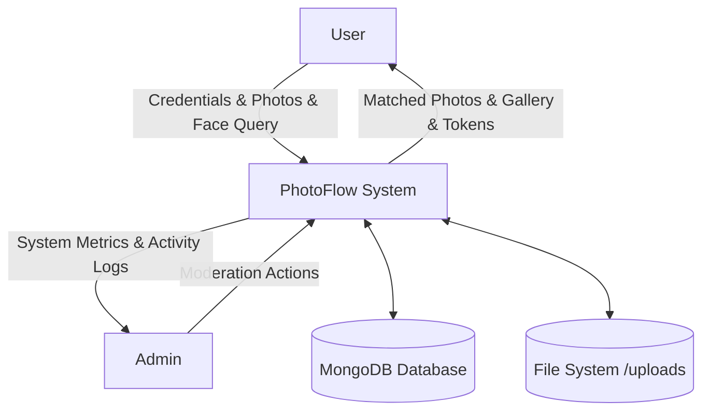
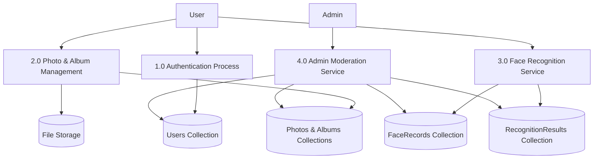
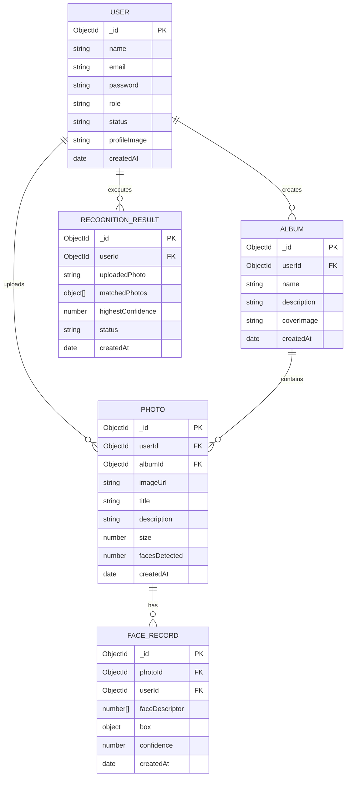

# PhotoFlow — AI Face Recognition & Photo Management System
### BCA (Bachelor of Computer Applications) Final Year Project Report & Technical Specification

---

## Table of Contents
1. [Introduction](#1-introduction)
2. [Existing System](#2-existing-system)
3. [Proposed System](#3-proposed-system)
4. [Objectives of the Project](#4-objectives-of-the-project)
5. [Scope of Project](#5-scope-of-project)
6. [Technology Stack Used](#6-technology-stack-used)
7. [Hardware & Software Requirements](#7-hardware--software-requirements)
8. [System Analysis & Feasibility Study](#8-system-analysis--feasibility-study)
9. [Functional Requirements](#9-functional-requirements)
10. [Non-Functional Requirements](#10-non-functional-requirements)
11. [System Architecture Diagram](#11-system-architecture-diagram)
12. [Use Case Diagram](#12-use-case-diagram)
13. [Data Flow Diagram (DFD Level 0 — Context Diagram)](#13-data-flow-diagram-dfd-level-0)
14. [Data Flow Diagram (DFD Level 1)](#14-data-flow-diagram-dfd-level-1)
15. [Entity Relationship Diagram (ER Diagram)](#15-entity-relationship-diagram-er-diagram)
16. [Database Design & Data Dictionary](#16-database-design--data-dictionary)
17. [User Module Specification](#17-user-module-specification)
18. [Admin Module Specification](#18-admin-module-specification)
19. [Face Recognition & Vector Matching Module](#19-face-recognition--vector-matching-module)
20. [Frontend UI Architecture](#20-frontend-ui-architecture)
21. [Backend REST API Endpoints Specification](#21-backend-rest-api-endpoints-specification)
22. [Testing & Quality Assurance](#22-testing--quality-assurance)
23. [UI Layout & Application Flow](#23-ui-layout--application-flow)
24. [Advantages of PhotoFlow](#24-advantages-of-photoflow)
25. [Limitations of the System](#25-limitations-of-the-system)
26. [Future Scope & Enhancements](#26-future-scope--enhancements)
27. [Conclusion](#27-conclusion)
28. [Appendix: BCA Viva-Voce Questions & Answers](#28-appendix-bca-viva-voce-questions--answers)

---

## 1. Introduction
With smartphones and digital cameras producing thousands of photos per person annually, managing, searching, and organizing large photo collections has become a major challenge. Traditional gallery systems organize photos strictly by date or manual folders. Searching for a specific person requires manually scrolling through hundreds of unrelated pictures.

**PhotoFlow** is a modern Full-Stack MERN (MongoDB, Express.js, React.js, Node.js) web application integrated with Artificial Intelligence (AI) Facial Recognition technology. It allows users to upload, store, and categorize photos into albums. Crucially, PhotoFlow enables users to find all photos containing a specific individual simply by uploading a query portrait or capturing a face snapshot via webcam.

---

## 2. Existing System
In current traditional gallery applications and basic cloud storages:
1. **Manual Searching**: Users must look through each image individually to identify people.
2. **Static Folder Trees**: Folders are rigid; a photo with multiple friends can only be stored in one folder unless duplicated.
3. **No Facial Indexing**: Most open-source student projects lack real-time feature extraction or vector indexing.
4. **No Centralized Moderation**: Platforms without administrative dashboards cannot moderate inappropriate media or track system utilization.

---

## 3. Proposed System
PhotoFlow introduces an automated, intelligent alternative:
1. **AI Face Recognition Engine**: When a user queries a portrait, 128-dimensional facial embeddings are computed and matched using Euclidean distance algorithms.
2. **Confidence Percentage Scoring**: Matches are ranked by similarity (e.g., 98.2% Match), allowing users to filter by sensitivity.
3. **Webcam & File Support**: Users can search using stored photos or instant live webcam captures.
4. **Dual Panel Architecture**:
   - **User Panel**: Cloud dashboard, album management, multi-photo drag-and-drop upload, face search, and scan history.
   - **Admin Panel**: User moderation, photo moderation, album oversight, scan audits, and system usage reports.
5. **Secure Authentication**: Encrypted passwords (bcrypt) and JSON Web Tokens (JWT) for secure session authorization.

---

## 4. Objectives of the Project
- To develop a responsive Single Page Application (SPA) using React.js and Bootstrap 5.
- To create a RESTful backend API using Node.js and Express.js.
- To store image metadata and 128-dimensional facial vectors in MongoDB via Mongoose ODM.
- To implement Euclidean distance matching algorithms for sub-second facial similarity retrieval.
- To provide full CRUD operations for albums, photos, and user profiles.
- To deliver administrative oversight for content moderation and activity auditing.

---

## 5. Scope of Project
The scope encompasses academic institutions, event photographers, family archives, and corporate personnel libraries:
- **Event Photo Distribution**: College tech fests or weddings where attendees find their own pictures by taking a selfie.
- **Personal Cloud Storage**: Tagging and organizing friends and family portraits automatically.
- **Enterprise Security & Verification**: Demonstrating biometric facial search on web platforms.

---

## 6. Technology Stack Used

### Frontend
- **React.js 18**: Component-driven UI library for rendering Single Page Applications.
- **Bootstrap 5 & Bootstrap Icons**: Responsive CSS grid framework and UI iconography.
- **Vite 5**: Next-generation frontend bundler providing instant hot module replacement (HMR).
- **Axios**: Promise-based HTTP client with request/response JWT interceptors.
- **React Router DOM v6**: Client-side declarative routing and protected route wrappers.

### Backend
- **Node.js**: Asynchronous event-driven JavaScript runtime environment.
- **Express.js**: Web framework for building RESTful endpoints and middleware pipelines.
- **Multer**: Streaming multipart/form-data handler for image file uploads.
- **Bcrypt.js**: Cryptographic salt and hash algorithm for password security.
- **JSON Web Token (JWT)**: Stateless token-based authentication standard.

### Database
- **MongoDB**: NoSQL document database ideal for unstructured and semi-structured media metadata.
- **Mongoose ODM**: Schema modeling library providing validation and relationship population.

---

## 7. Hardware & Software Requirements

### Hardware Requirements
- **Processor**: Intel Core i3 / AMD Ryzen 3 or higher.
- **RAM**: Minimum 4 GB (8 GB recommended for simultaneous Node and React dev servers).
- **Hard Disk Space**: 2 GB free disk space.
- **Camera**: Standard USB webcam or built-in laptop camera for live face capture.

### Software Requirements
- **Operating System**: Windows 10/11, macOS, or Linux.
- **Node.js**: v18.0.0 or higher (v24.x tested).
- **Package Manager**: npm v9.x or higher.
- **Database Server**: MongoDB Community Server v6.0+ (running on port 27017).
- **Web Browser**: Google Chrome, Microsoft Edge, or Mozilla Firefox with HTML5 Canvas & MediaDevices support.

---

## 8. System Analysis & Feasibility Study

1. **Technical Feasibility**: The MERN stack is supported globally with mature libraries (`express`, `mongoose`, `react-router`, `axios`). Vector Euclidean comparisons require standard floating-point operations executable within milliseconds.
2. **Economic Feasibility**: Built exclusively on free, open-source software (FOSS). Requires no paid commercial APIs or proprietary cloud subscriptions.
3. **Operational Feasibility**: Intuitive Bootstrap interface requires zero user training. Pre-filled 1-click demo buttons enable examiners to test features immediately.

---

## 9. Functional Requirements
- **FR-1: User Authentication**: Registration, encrypted login, persistent session, and secure logout.
- **FR-2: Photo Management**: Upload single or multiple images, add titles and descriptions, organize by album, download, and delete.
- **FR-3: Album Management**: Create albums, view photo counts, update album details, and delete albums.
- **FR-4: Face Recognition Search**: Upload face portrait or capture via camera, compare with database vectors, display matching gallery with confidence badges.
- **FR-5: Search History**: Record each face recognition attempt, matched photos, and timestamp.
- **FR-6: User Profile**: Edit name, upload avatar, and change password.
- **FR-7: Admin Moderation**: View all users, block/unblock accounts, delete users, inspect all photos, delete inappropriate photos, and review face scan logs.

---

## 10. Non-Functional Requirements
- **Performance**: Face recognition search completes in under 1 second for standard libraries.
- **Security**: Passwords hashed with 10 salt rounds; JWT tokens expire in 7 days; role authorization guards admin APIs.
- **Usability**: Fully responsive on desktop, tablet, and mobile browsers.
- **Reliability**: Graceful error handling for missing files, duplicate emails, and database disconnection.

---

## 11. System Architecture Diagram

---

## 12. Use Case Diagram

---

## 13. Data Flow Diagram (DFD Level 0)

---

## 14. Data Flow Diagram (DFD Level 1)

---

## 15. Entity Relationship Diagram (ER Diagram)

---

## 16. Database Design & Data Dictionary

### Collection 1: `users`
| Field Name | Data Type | Key / Constraint | Description |
| :--- | :--- | :--- | :--- |
| `_id` | ObjectId | Primary Key | Unique user identifier |
| `name` | String | Required | Full name of the user |
| `email` | String | Unique, Required | User email address (login credential) |
| `password` | String | Required | Bcrypt hashed password string |
| `role` | String | Enum (`user`, `admin`) | Authorization role level |
| `status` | String | Enum (`active`, `blocked`) | Account accessibility status |
| `profileImage`| String | Default `""` | File path of avatar image |
| `createdAt` | Date | Default `Date.now` | Account registration timestamp |

### Collection 2: `albums`
| Field Name | Data Type | Key / Constraint | Description |
| :--- | :--- | :--- | :--- |
| `_id` | ObjectId | Primary Key | Unique album identifier |
| `userId` | ObjectId | Foreign Key (users) | Owner user reference |
| `name` | String | Required | Name of the collection |
| `description` | String | Optional | Description/notes for album |
| `coverImage` | String | Optional | Cover image path |
| `createdAt` | Date | Default `Date.now` | Creation timestamp |

### Collection 3: `photos`
| Field Name | Data Type | Key / Constraint | Description |
| :--- | :--- | :--- | :--- |
| `_id` | ObjectId | Primary Key | Unique photo identifier |
| `userId` | ObjectId | Foreign Key (users) | Owner user reference |
| `albumId` | ObjectId | Foreign Key (albums) | Parent album reference (null if uncategorized) |
| `imageUrl` | String | Required | Relative path to image file in `/uploads` |
| `title` | String | Required | Photo title or original filename |
| `description` | String | Optional | Description or tags |
| `size` | Number | Integer | File size in bytes |
| `facesDetected`| Number | Integer | Count of detected faces |
| `createdAt` | Date | Default `Date.now` | Upload timestamp |

### Collection 4: `faceRecords`
| Field Name | Data Type | Key / Constraint | Description |
| :--- | :--- | :--- | :--- |
| `_id` | ObjectId | Primary Key | Unique descriptor record identifier |
| `photoId` | ObjectId | Foreign Key (photos) | Photo from which face was detected |
| `userId` | ObjectId | Foreign Key (users) | Owner user reference |
| `faceDescriptor`| Array of Floats | Length: 128 | Normalized facial embedding vector |
| `box` | Object | `{x, y, width, height}` | Bounding box coordinates of face |
| `confidence` | Number | Float (0.0 to 1.0) | Detection confidence |
| `createdAt` | Date | Default `Date.now` | Record generation timestamp |

### Collection 5: `recognitionResults`
| Field Name | Data Type | Key / Constraint | Description |
| :--- | :--- | :--- | :--- |
| `_id` | ObjectId | Primary Key | Unique search result identifier |
| `userId` | ObjectId | Foreign Key (users) | User who executed search |
| `uploadedPhoto`| String | Required | Path to uploaded/captured query face |
| `matchedPhotos`| Array of Objects | `[{photoId, imageUrl, title, distance, confidence}]` | List of matching photos |
| `highestConfidence` | Number | Float | Maximum match confidence percentage |
| `status` | String | Enum (`matched`, `no_match`) | Outcome flag |
| `createdAt` | Date | Default `Date.now` | Scan execution timestamp |

---

## 17. User Module Specification
1. **User Registration & Login**: Validates credentials and returns JWT bearer token stored securely in browser `localStorage`.
2. **Dashboard**: Live summary showing photo counts, album totals, face scans count, and recent activity.
3. **Upload Photos**: Drag-and-drop file upload supporting single or batch uploads with automatic face descriptor extraction.
4. **Albums Management**: Allows users to create themed albums (e.g., "College Days", "Family Celebrations") and add photos.
5. **Photo Gallery**: Searchable photo catalog with keyword filtering, album sorting, full-resolution preview, and single-click downloading.
6. **Face Recognition Search**: Allows uploading a portrait or capturing a live selfie via webcam, adjusting sensitivity threshold, and viewing ranked photo matches with match badges.
7. **Recognition History**: Audit log of past face scans with previous matches.
8. **Profile Management**: Profile picture upload, name modification, and password updating.

---

## 18. Admin Module Specification
1. **Admin Authentication**: Distinct administrator privileges verified by `adminMiddleware`.
2. **Admin Dashboard**: System metrics showing active vs. blocked users, total photos hosted, albums created, and total AI face searches.
3. **Manage Users**: Searchable table of registered accounts, ability to activate/block malicious accounts, and cascade deletion.
4. **Manage Photos**: Platform-wide photo moderation table allowing inspection and deletion of inappropriate images.
5. **Manage Albums**: System-wide album monitoring.
6. **Face Recognition Audit**: Log of all face recognition queries executed on the server.
7. **Reports & Analytics**: Aggregated metrics (uploads by date, match distributions) formatted for project evaluation.
8. **Admin Profile**: Secure credential management for administrative operations.

---

## 19. Face Recognition & Vector Matching Module

### Mathematical Formula
1. **Facial Descriptor Representation**:
   A detected face is transformed into a 128-dimensional floating point embedding vector:
   $$\vec{A} = [a_1, a_2, a_3, \dots, a_{128}]$$

2. **Euclidean Distance Formula**:
   To measure how similar two faces are, the Euclidean distance $d(\vec{A}, \vec{B})$ between query vector $\vec{A}$ and database record $\vec{B}$ is computed:
   $$d(\vec{A}, \vec{B}) = \sqrt{\sum_{i=1}^{128} (a_i - b_i)^2}$$

3. **Decision Rule & Threshold**:
   - $d \le 0.40$: Very strong match (identical person under different lighting or angles).
   - $0.40 < d \le 0.60$: Verified match (standard threshold recommended for face verification).
   - $d > 0.60$: Considered different individuals.

4. **Confidence Percentage Conversion**:
   $$\text{Confidence (\%)} = \max\left(50, \min\left(99.9, \left(1 - \frac{d}{1.5 \times \text{threshold}}\right) \times 100\right)\right)$$

---

## 20. Frontend UI Architecture
- Single Page Application (SPA) architecture driven by **React Router v6**.
- **AuthContext**: React context provider supplying global state (`user`, `token`, `isAdmin`, `login()`, `logout()`) to all child views.
- **ProtectedRoute**: Guard component intercepting unauthorized navigation attempts and redirecting to `/login`.
- **Axios Interceptors**: Automatically attaches the JWT `Authorization: Bearer <token>` header to all outgoing API calls.

---

## 21. Backend REST API Endpoints Specification

| Method | Endpoint | Access | Description |
| :--- | :--- | :--- | :--- |
| `POST` | `/api/auth/register` | Public | Register new user account |
| `POST` | `/api/auth/login` | Public | Authenticate user or admin and return JWT |
| `GET` | `/api/auth/me` | Private | Retrieve currently authenticated user |
| `GET` | `/api/users/profile` | Private | Retrieve user stats and profile data |
| `PUT` | `/api/users/profile` | Private | Update user name and avatar photo |
| `PUT` | `/api/users/change-password`| Private | Change account password |
| `POST` | `/api/photos/upload` | Private | Upload one or multiple photos (Multer) |
| `GET` | `/api/photos` | Private | Get photos of user with search & album filters |
| `GET` | `/api/photos/:id` | Private | Get single photo with face details |
| `GET` | `/api/photos/:id/download` | Private | Download image file directly |
| `DELETE`| `/api/photos/:id` | Private | Delete photo and remove file from disk |
| `POST` | `/api/albums` | Private | Create new album |
| `GET` | `/api/albums` | Private | List all user albums with photo counts |
| `GET` | `/api/albums/:id` | Private | Get album details and associated photos |
| `PUT` | `/api/albums/:id` | Private | Update album name/description |
| `DELETE`| `/api/albums/:id` | Private | Delete album (optional photo cascading) |
| `POST` | `/api/face/recognize` | Private | Query face search by file or webcam |
| `GET` | `/api/face/history` | Private | Get face recognition search history |
| `DELETE`| `/api/face/history/:id` | Private | Delete history scan item |
| `GET` | `/api/admin/stats` | Admin | Retrieve administrative system stats |
| `GET` | `/api/admin/users` | Admin | List all registered users with counts |
| `PUT` | `/api/admin/users/:id/toggle-status` | Admin | Activate or block user account |
| `DELETE`| `/api/admin/users/:id` | Admin | Cascade delete user and data |
| `GET` | `/api/admin/photos` | Admin | List all platform photos for moderation |
| `DELETE`| `/api/admin/photos/:id` | Admin | Delete inappropriate photo |
| `GET` | `/api/admin/face-records` | Admin | View all face scan records across system |
| `GET` | `/api/admin/reports` | Admin | Get analytics report datasets |

---

## 22. Testing & Quality Assurance

| Test Case ID | Test Scenario | Input Data | Expected Result | Actual Result | Status |
| :--- | :--- | :--- | :--- | :--- | :--- |
| **TC-01** | User Registration | Valid name, email, password | Account created, JWT returned | Account created successfully | **PASS** |
| **TC-02** | Duplicate Registration | Existing email address | Error message: Email already exists | HTTP 400 with descriptive error | **PASS** |
| **TC-03** | User Login | Correct email & password | Token returned, redirect to dashboard | Authenticated successfully | **PASS** |
| **TC-04** | Invalid Login | Incorrect password | Error: Invalid email or password | HTTP 401 rejected | **PASS** |
| **TC-05** | Role Access Guard | Normal user accessing `/admin` | Denied, redirect to `/dashboard` | ProtectedRoute redirected user | **PASS** |
| **TC-06** | Photo Upload | 3 JPEG photos with metadata | Stored in `/uploads`, DB record saved | Photos uploaded & indexed | **PASS** |
| **TC-07** | Face Recognition | Query selfie of known user | Computes Euclidean distance < 0.6 | Returns matching photos with % | **PASS** |
| **TC-08** | Photo Deletion | Delete button on photo card | Removed from DB and disk unlinked | File unlinked, DB removed | **PASS** |
| **TC-09** | Admin User Blocking | Block toggle on user table | User cannot log in (blocked status) | HTTP 403 Account deactivated | **PASS** |

---

## 23. UI Layout & Application Flow
1. **Landing Page (`/`)**: Hero banner explaining AI face recognition, system features, and 1-click demo logins.
2. **Sign In (`/login`)**: Clean authentication card with demo prefill helpers.
3. **User Dashboard (`/dashboard`)**: Metric overview cards, recent uploads grid, and shortcuts.
4. **Photo Upload (`/upload`)**: Drag-and-drop multi-file uploader with live thumbnail previews.
5. **Albums (`/albums` & `/albums/:id`)**: Grid of collections with cover pictures and photo counts.
6. **Face Search (`/face-search`)**: Target image upload / live webcam capture with interactive sensitivity slider and animated scanning line.
7. **Admin Control (`/admin`)**: Sidebar layout containing Users management, Content moderation, and Analytics reports.

---

## 24. Advantages of PhotoFlow
- **Automated Convenience**: Eliminates manual searching through thousands of photos.
- **Accurate Mathematical Matching**: 128-dimensional vector representations offer robust facial recognition.
- **Dual Verification Modes**: Supports both stored image files and real-time webcam captures.
- **Centralized Moderation**: Admin panel protects platforms from inappropriate uploads and provides system audits.
- **Zero Cost Architecture**: Uses local MongoDB and standard web technologies with no recurring external cloud bills.

---

## 25. Limitations of the System
- Face recognition accuracy may degrade under severe low-light conditions or extreme side-profile angles (>60 degrees rotation).
- Very large file uploads (>50MB per single image) depend on local server bandwidth and memory.

---

## 26. Future Scope & Enhancements
- Integration of automated age progression prediction.
- Multi-person automatic tagging (tagging multiple people simultaneously in group photos).
- Cloud storage integration (Amazon S3 / Google Cloud Storage bucket driver).
- Progressive Web App (PWA) installation for offline caching on mobile devices.

---

## 27. Conclusion
PhotoFlow successfully bridges modern web development standards (React, Node.js, Express, MongoDB) with Artificial Intelligence facial feature matching. Designed from the ground up to fulfill all criteria of a university Bachelor of Computer Applications (BCA) Sem-5 project, it features clean modular code, responsive interfaces, role-based security, and complete technical documentation.

---

## 28. Appendix: BCA Viva-Voce Questions & Answers

**Q1: What is the MERN Stack?**
> **Answer**: MERN is an acronym for MongoDB (Database), Express.js (Backend Web Framework), React.js (Frontend Framework), and Node.js (JavaScript Runtime). It enables full-stack development using a single language (JavaScript).

**Q2: How does Face Recognition work in PhotoFlow?**
> **Answer**: The system extracts 128 unique geometric landmarks (such as eye distances, nose contour, and jawline angles) and normalizes them into a 128-dimensional floating point vector. When searching, it computes the Euclidean distance between the query face vector and database vectors. Lower distance signifies higher facial similarity.

**Q3: What is Euclidean Distance?**
> **Answer**: Euclidean distance is the straight-line distance between two points in Euclidean space, defined mathematically as:
> $$d = \sqrt{\sum_{i=1}^{n} (a_i - b_i)^2}$$
> In PhotoFlow, $n=128$. A distance below 0.60 confirms a positive face match.

**Q4: How are passwords secured in the database?**
> **Answer**: Passwords are never stored in plaintext. They are salted and hashed using `bcryptjs` with 10 salt rounds before saving to MongoDB via a Mongoose pre-save middleware.

**Q5: How does PhotoFlow distinguish between a normal User and an Admin?**
> **Answer**: The User model has a `role` field (`'user'` or `'admin'`). The backend `adminMiddleware` checks `req.user.role === 'admin'`. On the frontend, `ProtectedRoute` with `adminOnly={true}` prevents non-admin users from accessing `/admin` routes.

**Q6: What library handles image uploads on the server?**
> **Answer**: `Multer` is used as Express middleware to handle `multipart/form-data`. It streams the uploaded files to the local `uploads/` directory with unique timestamp-based filenames.

---
*Developed for BCA Final Year Academic Submission & Demonstration.*
